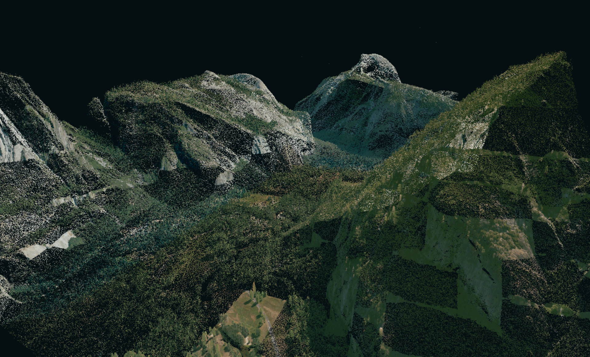
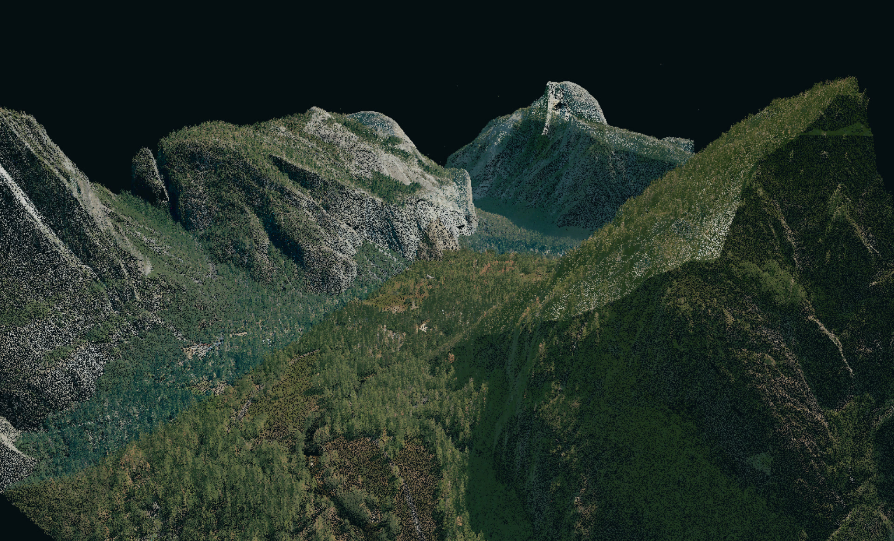
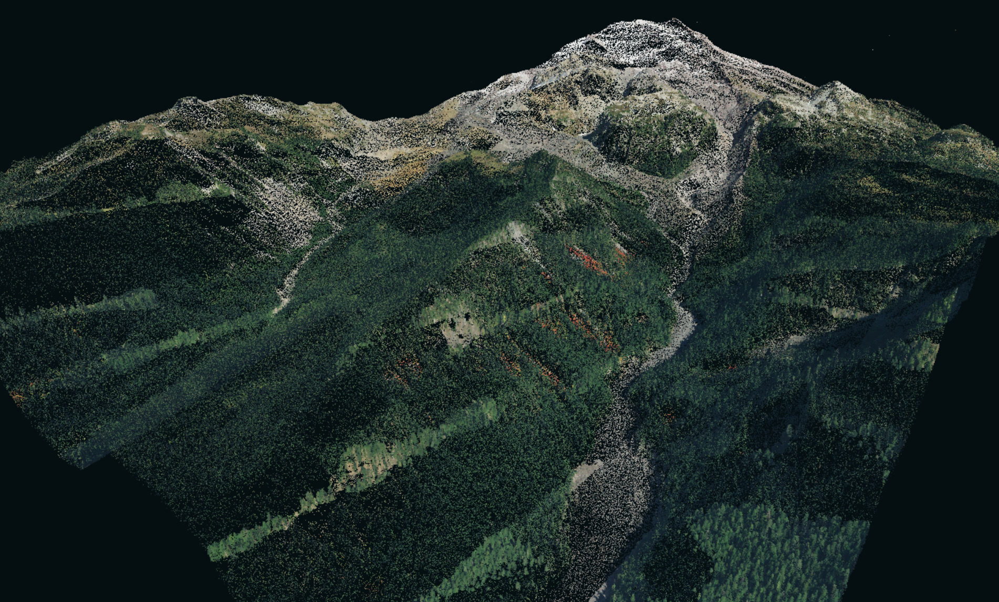
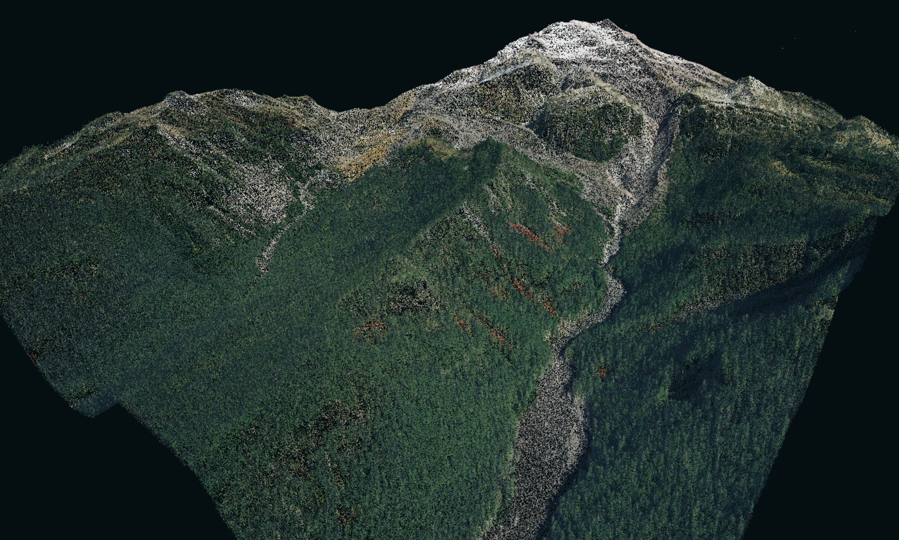
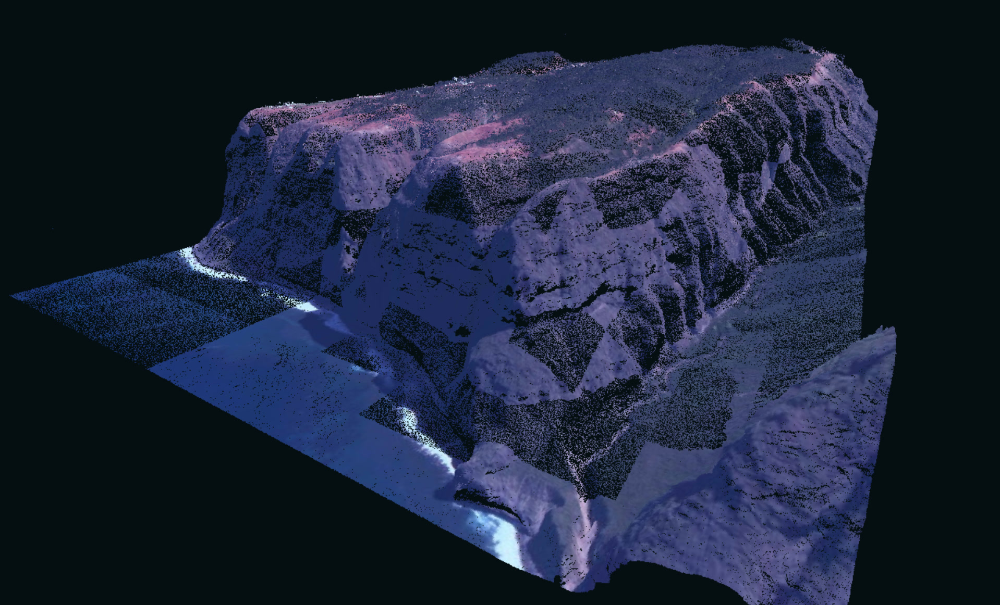
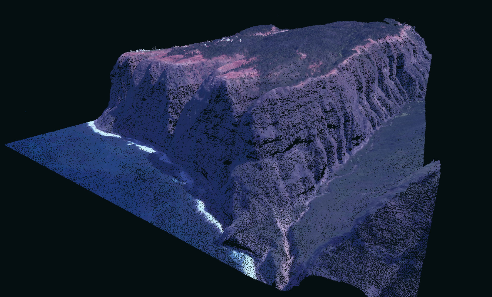
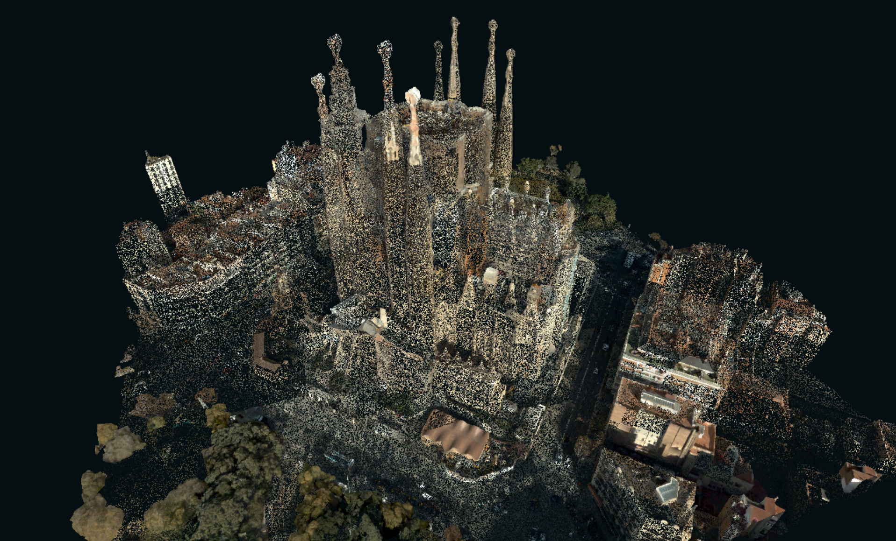
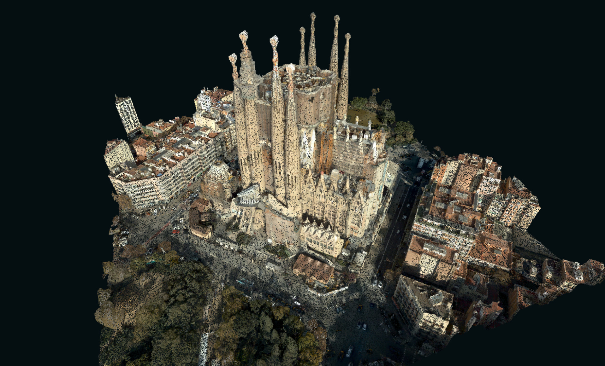

# D3D12 Real-Time LiDAR Renderer

A from-scratch Direct3D 12 renderer for exploring large LAS, LAZ, and COPC point clouds.

The project compares two detail-selection methods under the same point budget:

- **Discrete octree LOD:** the CPU selects complete hierarchy nodes.
- **GPU Continuous LOD:** a compute shader selects and compacts individual points according to camera distance and point spacing.

## LOD vs Continuous LOD

Each pair uses the same viewpoint and an approximately **3.5 million point draw budget**. Continuous LOD distributes those points more evenly and reduces the visible region boundaries created when complete octree nodes refine at once.

<table>
  <tr>
    <th width="50%">Discrete octree LOD</th>
    <th width="50%">GPU Continuous LOD</th>
  </tr>
  <tr>
    <td colspan="2" align="center"><strong>Yosemite Valley</strong></td>
  </tr>
  <tr>
    <td></td>
    <td></td>
  </tr>
  <tr>
    <td colspan="2" align="center"><strong>Mount Rainier</strong></td>
  </tr>
  <tr>
    <td></td>
    <td></td>
  </tr>
  <tr>
    <td colspan="2" align="center"><strong>Na Pali Coast</strong></td>
  </tr>
  <tr>
    <td></td>
    <td></td>
  </tr>
  <tr>
    <td colspan="2" align="center"><strong>Sagrada Família</strong></td>
  </tr>
  <tr>
    <td></td>
    <td></td>
  </tr>
</table>

## Technical highlights

- Direct3D 12 rendering with frames in flight, copy and direct queues, fences, and GPU timing.
- Bounded asynchronous tile loading with cancellation and fence-safe GPU resource retirement.
- LAS, LAZ, and COPC decoding through LASzip.
- CPU octree traversal with frustum culling, spacing error, hysteresis, and a global point budget.
- GPU compute reduction into a compacted point buffer followed by `ExecuteIndirect` drawing.
- Runtime switching between Discrete LOD and Continuous LOD.
- RGB, classification, and elevation colouring modes.
- Debug views for octree node bounds and individual CLOD levels.

The Continuous LOD implementation is based on [*Real-Time Continuous Level of Detail Rendering of Point Clouds*](https://www.cg.tuwien.ac.at/research/publications/2019/schuetz-2019-CLOD/) by Markus Schütz, Katharina Krösl, and Michael Wimmer.

## Controls

| Input | Action |
|---|---|
| `W` `A` `S` `D`, `Q` `E` | Move the camera |
| Right mouse drag / Arrow keys | Look around |
| `Shift` / `Ctrl` | Faster / precise movement |
| `R` | Frame the dataset |
| `1` / `2` | Source / elevation colours |
| `C` | Switch between Discrete LOD and CLOD |
| `[` / `]` | Adjust CLOD density |
| `V` | Cycle CLOD level views |
| `O` | Toggle selected octree bounds |
| `B` | Run the fixed-view benchmark |

## Build and run

Requirements: Windows 10/11, a Direct3D 12 GPU, Visual Studio 2022 with C++, the Windows SDK, CMake, and Ninja.

```powershell
cmake -S . -B out/build/x64-Release -G Ninja -DCMAKE_BUILD_TYPE=Release
cmake --build out/build/x64-Release

& ".\out\build\x64-Release\PointCloudRenderer.exe" `
    "C:\point-clouds\tile-01.copc.laz" `
    "C:\point-clouds\tile-02.copc.laz"
```

Public point-cloud datasets used for testing came from [OpenTopography](https://opentopography.org/), with colour imagery from the USGS. Dataset files are not included in the repository.
