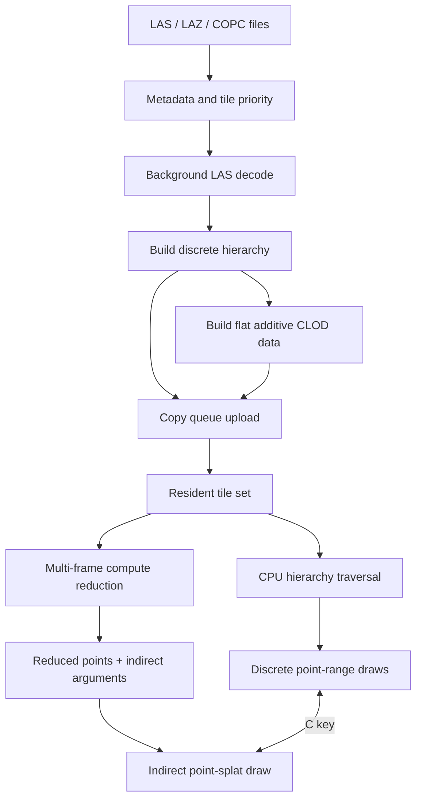

# D3D12 Real-Time LiDAR Renderer

A from-scratch Direct3D 12 point-cloud renderer for exploring large LAS, LAZ, and COPC datasets. It combines asynchronous tile streaming with two runtime-selectable level-of-detail paths: a conventional CPU-selected hierarchy and an experimental GPU-driven continuous LOD implementation.

The project was built to study practical graphics systems: D3D12 resource ownership, frames in flight, copy and direct queues, GPU synchronization, spatial data structures, out-of-core residency, compute compaction, indirect drawing, and performance measurement.

## Highlights

- Loads one or more `.las`, `.laz`, or `.copc.laz` files through LASzip.
- Converts large geospatial coordinates into a stable local, Y-up coordinate system.
- Streams tiles through a bounded asynchronous decode, hierarchy-build, upload, and residency pipeline.
- Cooperatively cancels obsolete LAS decoding and hierarchy work.
- Uploads point data through a dedicated D3D12 copy queue.
- Retires evicted GPU buffers only after their fence completes.
- Switches between discrete hierarchy LOD and GPU continuous LOD with **C**.
- Compacts selected CLOD points with a compute shader over multiple frames.
- Draws the generated point count with `ExecuteIndirect`, without a CPU count readback.
- Renders variable-size circular point splats with distance-based growth.
- Supports source classification colours and a terrain-style elevation gradient.
- Reports frame time, CPU/GPU timing, selected points, tile residency, memory, CLOD progress, and overflow.
- Includes a fixed-view benchmark that records average, maximum, p95, and p99 frame times.

## LOD modes

### Discrete hierarchy LOD

Each loaded tile is organized into an octree-like hierarchy. The CPU traverses that hierarchy using projected point spacing, frustum culling, hysteresis, and a global point budget.

When a node needs more detail, the renderer replaces its representative range with ranges from its children. This is efficient and works well for streamed datasets, but exchanging whole node ranges can produce visible density changes or popping.

### Continuous LOD

The experimental CLOD path is inspired by *Real-Time Continuous Level of Detail Rendering of Point Clouds* by Markus Schütz, Katharina Krösl, and Michael Wimmer.

Every original point is assigned once to an additive hierarchy level and stored in a flat per-tile source buffer:

```text
position.xyz | packed colour + hierarchy level
```

A compute shader evaluates resident source points individually. It:

1. Projects each point into the reduction view.
2. Derives the point's represented spacing from its hierarchy level.
3. Calculates the desired spacing from camera distance and the CLOD factor.
4. Uses a stable per-point random fraction to soften integer-level boundaries.
5. Appends useful points into a shared reduced buffer.

The latest complete reduced buffer remains drawable while the next one is assembled over several frames. The GPU-written point count becomes an indirect draw argument, and each surviving point is rendered as a camera-facing circular splat. Newly eligible points grow through a distance-based blend range instead of appearing immediately at full size.

## Pipeline



The tile streamer decides **which source tiles are resident**. The selected render mode decides **which points from those tiles are drawn**.

## Resource lifetime model

Tiles move through an explicit lifecycle:

```text
Unloaded -> Queued -> Loading -> ReadyForUpload
         -> Uploading -> Resident -> Retiring -> Unloaded
```

- Request generations prevent stale worker results from reviving cancelled tiles.
- Stop tokens allow long CPU loops to exit cooperatively.
- Copy fences protect upload resources.
- Direct-queue retirement fences protect buffers referenced by submitted draws or dispatches.
- An active CLOD reduction temporarily pins its source tiles.
- Source-set generations prevent a completed reduction from drawing stale or evicted tiles.
- Output overflow remains inside the fixed allocation and automatically raises the next CLOD factor.

## Controls

| Input | Action |
|---|---|
| `W` `A` `S` `D` | Move horizontally |
| `Q` / `E` | Move down / up |
| Right mouse drag | Look around |
| Arrow keys | Adjust yaw and pitch |
| `Shift` | Move faster |
| `Ctrl` | Move precisely |
| `R` | Frame the complete dataset |
| `1` | Classification colours |
| `2` | Elevation colours |
| `C` | Switch between Discrete and CLOD rendering |
| `[` / `]` | Increase / decrease CLOD density |
| `L` | Toggle budgeted discrete LOD / full detail |
| `B` | Run the fixed-view benchmark |

The benchmark appends its results to `PointCloudRenderer_Benchmark.txt` in the process working directory.

## Requirements

- Windows 10 or 11
- A Direct3D 12 capable GPU
- Visual Studio 2022 with **Desktop development with C++**
- Windows 10/11 SDK with `dxc.exe`
- CMake 3.24 or newer
- Ninja or another CMake-supported generator
- Internet access during the first configure so CMake can fetch LASzip 3.5.0

## Build

Open the repository as a CMake folder in Visual Studio 2022 and build the `PointCloudRenderer` target, or use a **Developer PowerShell for Visual Studio 2022** terminal:

```powershell
cmake -S . -B out/build/x64-Release -G Ninja -DCMAKE_BUILD_TYPE=Release
cmake --build out/build/x64-Release
```

For a debug build, replace `x64-Release` and `Release` with `x64-Debug` and `Debug`.

## Run

Pass one or more point-cloud files as command-line arguments:

```powershell
& ".\out\build\x64-Release\PointCloudRenderer.exe" `
    "C:\point-clouds\tile-01.copc.laz" `
    "C:\point-clouds\tile-02.copc.laz"
```

To launch every LAZ tile in a folder:

```powershell
$tiles = @(
    Get-ChildItem "C:\point-clouds\dataset" -Filter "*.laz" -File |
    Sort-Object Name |
    ForEach-Object FullName
)

& ".\out\build\x64-Release\PointCloudRenderer.exe" @tiles
```

Datasets are excluded from the repository because they are commonly hundreds of megabytes or several gigabytes.

## Performance tuning

The default limits are compile-time constants so experiments remain repeatable:

| Setting | Location | Purpose |
|---|---|---|
| `PointMemoryBudgetBytes` | `src/Application.h` | Combined resident discrete and CLOD tile data |
| `MaximumDrawnPoints` | `src/Application.h` | CLOD output capacity and discrete draw budget |
| `ClodReductionSourcePointBudgetPerFrame` | `src/D3D12Context.h` | Maximum source points examined by compute each frame |

The current defaults favor predictable behavior during development. A 6 GB GTX 1660 Super can use larger limits, but the tile budget should leave room for two reduced CLOD buffers, swap-chain and depth resources, the desktop compositor, and other applications. Benchmark Release builds after each increase rather than allocating the full advertised VRAM.

## Project structure

- **Application:** Win32 lifetime, input, tile priority, lifecycle transitions, residency, mode switching, and benchmarks.
- **TileLoadWorker:** bounded C++20 background work, generation checks, and cooperative cancellation.
- **LasPointCloudLoader:** metadata inspection, LASzip decoding, coordinate conversion, and render attributes.
- **PointCloudHierarchyBuilder:** spatial subdivision, representative sampling, additive CLOD levels, bounds, and spacing.
- **D3D12Context:** device and swap chain, frames in flight, queues, uploads, descriptors, compute reduction, indirect drawing, timing, and fence-safe retirement.
- **ClodReduce.hlsl:** point-wise frustum, spacing, randomization, and compaction logic.
- **ClodDraw.hlsl:** indirect instanced splats, point growth, colouring, and circular pixel masking.

## Current limitations

- COPC files are currently decoded as ordinary LAZ files; native COPC hierarchy traversal and HTTP range streaming are future work.
- The hierarchy and flat CLOD representation are rebuilt instead of cached on disk.
- Each tile retains both its discrete and CLOD representations to support immediate comparison.
- Multi-frame CLOD results are complete and stable, but swapping camera-dependent point subsets can still show layering during quick movement.
- The CLOD reduction scans resident source points repeatedly; it is a research implementation rather than a final production policy.
- The renderer currently targets Windows and Direct3D 12.

## Roadmap

- Record a repeatable Discrete versus CLOD fly-through and publish benchmark results.
- Add a scripted camera path for matching captures.
- Use native COPC hierarchy traversal for regional and remote streaming.
- Cache preprocessed hierarchy and CLOD data.
- Explore VR rendering, stereo views, and motion-aware peripheral coverage.

## Dataset note

The renderer is tested with public LiDAR datasets. Dataset files are not redistributed in this repository.
