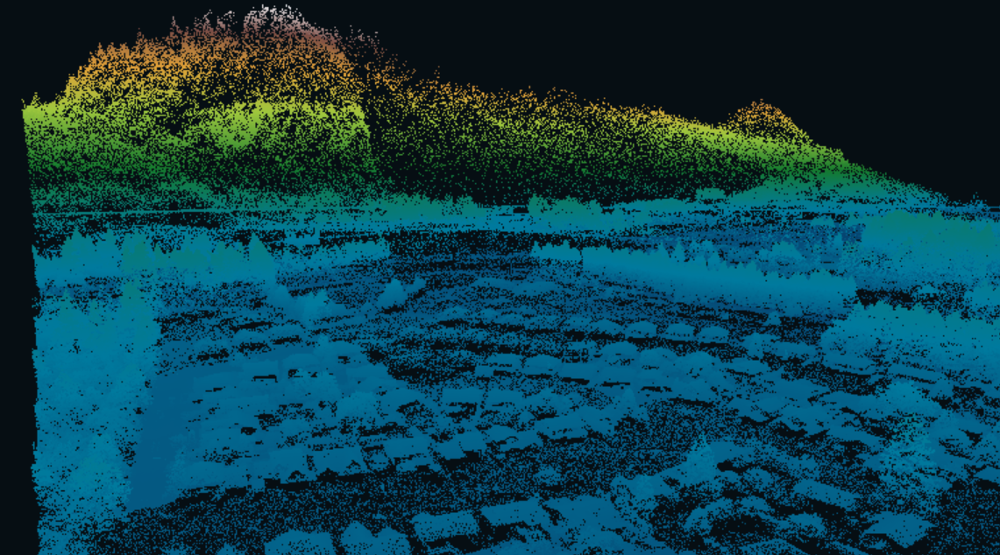
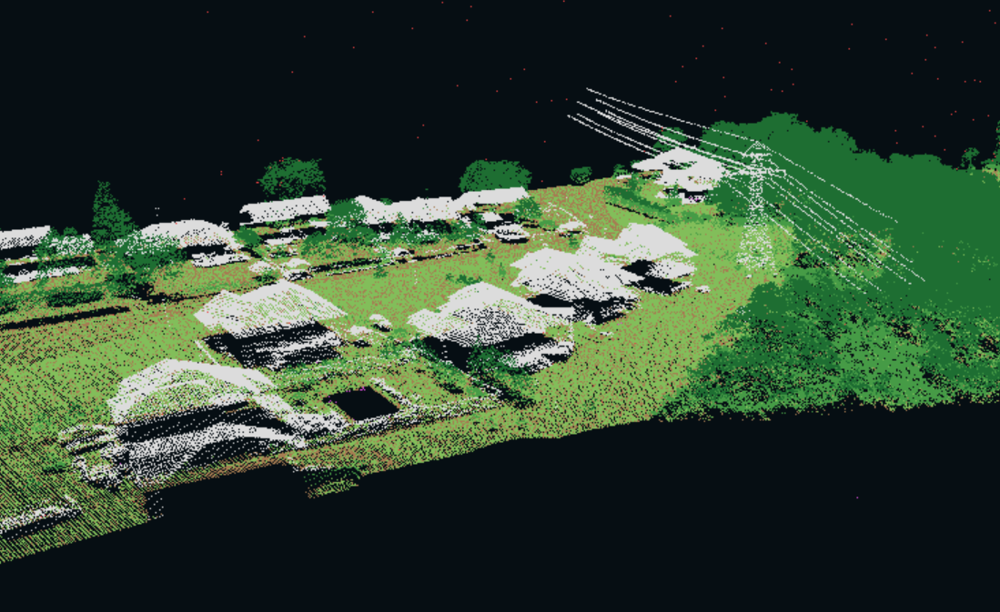
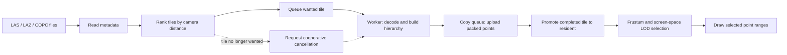

# D3D12 Real-Time LiDAR Renderer

A from-scratch Direct3D 12 point-cloud renderer for exploring large LAS, LAZ, and COPC datasets in real time. The project focuses on the systems behind a practical renderer: GPU resource ownership, spatial level of detail, tile residency, point budgets, culling, and performance measurement.

> Built as a hands-on graphics programming project using C++20, Win32, Direct3D 12, HLSL, CMake, and LASzip.

## Gallery

| Elevation colouring — Hope, British Columbia | Classification colouring — Niagara, Ontario |
|:---:|:---:|
|  |  |

## What it does

- Loads one or more `.las`, `.laz`, or `.copc.laz` files through LASzip.
- Reads point counts, bounds, coordinate systems, classifications, and available attributes.
- Converts large geospatial coordinates into a stable local, Y-up coordinate system.
- Decodes tiles and builds their octree-like point hierarchies on a background worker thread.
- Cooperatively cancels unwanted work during LASzip decoding and hierarchy construction.
- Uploads point buffers through a dedicated D3D12 copy queue without waiting for the GPU each frame.
- Selects detail using projected point spacing, view-frustum culling, hysteresis, and a global point budget.
- Keeps nearby tiles resident under a configurable point-memory budget and a stable tile lifecycle.
- Safely abandons pending uploads and retires evicted buffers only after their fences complete.
- Renders classification colours or a terrain-style elevation gradient.
- Displays live FPS, frame time, CPU/GPU timing, point counts, memory usage, tile residency, draw ranges, and culled nodes in the window title.
- Includes a repeatable fixed-view benchmark mode.

## Rendering pipeline



The render thread polls worker results and copy-fence progress without waiting for either stage. CPU preparation and GPU upload are separately bounded so large temporary point arrays cannot accumulate. The current COPC path still reads each file sequentially through LASzip; native COPC hierarchy traversal and HTTP range streaming are future work.

## Controls

| Input | Action |
|---|---|
| `W` `A` `S` `D` | Move horizontally |
| `Q` / `E` | Move down / up |
| Right mouse drag | Look around |
| Arrow keys | Adjust yaw and pitch |
| `Shift` | Move faster |
| `Ctrl` | Move precisely |
| `R` | Frame the complete dataset |
| `1` | Classification colours |
| `2` | Elevation colours |
| `L` | Toggle budgeted LOD / full detail |
| `B` | Run the fixed-view benchmark |

Full-detail mode intentionally bypasses the global draw budget. Large datasets can overwhelm an integrated GPU in this mode.

## Requirements

- Windows 10 or 11
- A Direct3D 12 capable GPU
- Visual Studio 2022 with **Desktop development with C++**
- Windows 10/11 SDK with `dxc.exe`
- CMake 3.24 or newer
- Ninja or another CMake-supported generator
- Internet access during the first configure so CMake can fetch LASzip 3.5.0

## Build

The easiest route is to open the repository as a CMake folder in Visual Studio 2022 and build the `PointCloudRenderer` target.

From a **Developer PowerShell for Visual Studio 2022** terminal:

```powershell
cmake -S . -B out/build/x64-Release -G Ninja -DCMAKE_BUILD_TYPE=Release
cmake --build out/build/x64-Release
```

For a debug build, replace `x64-Release` and `Release` with `x64-Debug` and `Debug`.

## Run

Pass one or more point-cloud files as command-line arguments:

```powershell
& ".\out\build\x64-Release\PointCloudRenderer.exe" "C:\point-clouds\tile-01.copc.laz" "C:\point-clouds\tile-02.copc.laz"
```

To launch every tile in a folder without PowerShell line-continuation characters:

```powershell
$tiles = @(
    Get-ChildItem "C:\point-clouds\dataset" -Filter "*.laz" -File |
    Sort-Object Name |
    ForEach-Object FullName
)

& ".\out\build\x64-Release\PointCloudRenderer.exe" @tiles
```

Point-cloud datasets are intentionally excluded from the repository because they are often hundreds of megabytes or several gigabytes.

## Current architecture

- **Application:** Win32 lifetime, input, dataset coordination, tile priority, lifecycle transitions, residency, LOD selection, and benchmark state.
- **Tile load worker:** one bounded C++20 worker thread for decoding and hierarchy preparation, with generation checks and cooperative stop tokens for stale requests.
- **LAS loader:** metadata inspection, LASzip decoding, coordinate conversion, classification colours, and periodic cancellation checks.
- **Hierarchy builder:** cancellable spatial subdivision, leaf packing, representative sampling, bounds, and spacing estimates.
- **D3D12 context:** device and swap chain ownership, frames in flight, a dedicated copy queue, asynchronous point uploads, fence-safe abandonment and retirement, timing queries, and drawing.
- **HLSL shader:** camera transformation plus classification or elevation colouring.

Tiles move through an explicit lifecycle:

```text
Unloaded -> Queued -> Loading -> ReadyForUpload
         -> Uploading -> Resident -> Retiring -> Unloaded
```

Request generations prevent stale worker results from reviving an unwanted tile. Stop tokens avoid finishing obsolete CPU work, while copy and direct-queue fences keep GPU resources alive until their last command completes.

## Current limitations

- COPC files are decoded as ordinary LAZ files; the internal COPC hierarchy is not yet used for partial loading.
- The hierarchy is rebuilt when a tile is loaded instead of being cached on disk.
- Upload-buffer allocation and the CPU staging copy still begin on the main thread before the copy queue takes over.
- The streaming pipeline intentionally uses one CPU preparation job and one GPU upload at a time to keep temporary memory predictable.
- The renderer currently targets Windows and Direct3D 12.

The next research milestone explores continuous, budget-aware LOD refinement and compares it with the current discrete hierarchy traversal. Native COPC streaming and hierarchy caching remain longer-term extensions.

## Dataset note

The screenshots use Canadian public LiDAR data. Dataset files are not redistributed in this repository.
